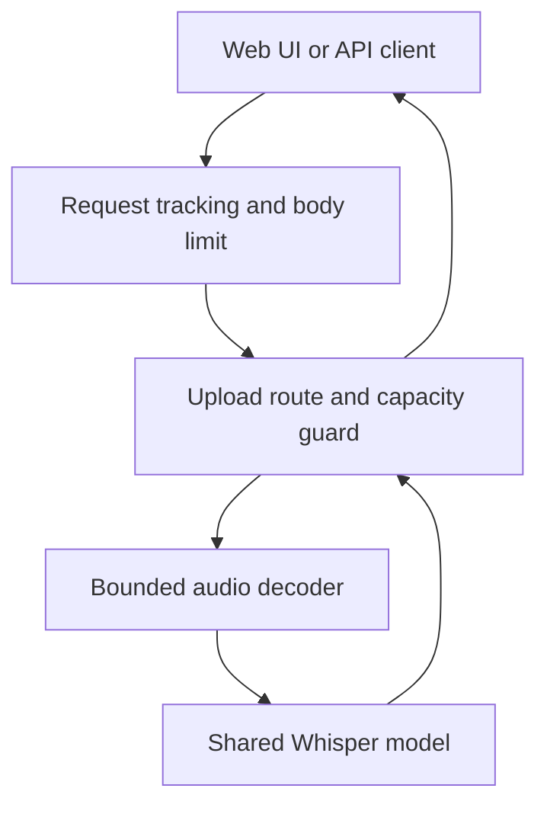

# MediaScribe

**Turn audio and video into text with local speech recognition.**

MediaScribe is a Python service built with FastAPI, faster-whisper and PyAV. Upload a media file through the web interface or REST API to receive a transcript, detected language and processing metadata.

Inference runs locally on CPU. No paid transcription API or GPU is required.

## Highlights

- **Audio and video input:** decode the first audio stream and normalize it to mono, 16 kHz audio.
- **Simple web interface:** file upload, processing state, transcript display, clipboard copy and error feedback.
- **Bounded input processing:** file-size checks, raw request-body limits before multipart parsing, and duration limits enforced while decoding.
- **Explicit concurrency policy:** one active processing request; additional requests receive `503` with `Retry-After`.
- **Operational visibility:** request IDs, timing logs, liveness and readiness endpoints.
- **Resource cleanup:** temporary request buffers and media files are cleaned up on normal completion and handled failures.
- **Docker support:** separate test/runtime targets, an unprivileged runtime user and persistent model cache.
- **19 automated tests:** API behavior, real audio decoding and request-body middleware.

## Quick start

### Docker

Requirements: Docker Engine or Docker Desktop with Linux containers, Docker Compose, and an available port 8000. Initial image and model downloads require internet access.

Run from the project root:

```bash
docker compose up --build
```

Wait for `Application startup complete.`, then open:

| URL | Purpose |
|---|---|
| http://127.0.0.1:8000/ | Web interface |
| http://127.0.0.1:8000/docs | Interactive API documentation |
| http://127.0.0.1:8000/health | Liveness |
| http://127.0.0.1:8000/ready | Model readiness |

Choose a file and click **Transcribe**. The first start downloads the model and may take several minutes. The server remains attached to the terminal while running.

Stop with Ctrl+C. To remove containers and the project network:

```bash
docker compose down
```

The model cache is stored in a named volume and survives `down`. Using `down -v` also deletes that cache.

### Local Python

Python 3.10 was tested. Run commands from the project root.

**Windows PowerShell**

```powershell
py -3.10 -m venv .venv
.\.venv\Scripts\python.exe -m pip install -r requirements-dev.txt
.\.venv\Scripts\python.exe -m pip check
.\.venv\Scripts\python.exe -m uvicorn main:app --host 127.0.0.1 --port 8000
```

**Linux**

```bash
python3.10 -m venv .venv
.venv/bin/python -m pip install -r requirements-dev.txt
.venv/bin/python -m pip check
.venv/bin/python -m uvicorn main:app --host 127.0.0.1 --port 8000
```

Use `requirements.txt` instead of `requirements-dev.txt` for application-only dependencies. Linux installations need the OpenMP runtime used by CTranslate2; the Docker image installs `libgomp1`.

PyAV handles media decoding without invoking an external FFmpeg executable.

## API usage

### Transcribe a file

`POST /transcriptions` accepts a multipart form with a file in the `file` field.

```bash
curl -X POST http://127.0.0.1:8000/transcriptions -F "file=@recording.m4a"
```

On Windows PowerShell, use `curl.exe`:

```powershell
curl.exe -X POST http://127.0.0.1:8000/transcriptions -F "file=@recording.m4a"
```

Example success response; values are illustrative:

```json
{
  "text": "Hello, this is a transcription test.",
  "language": "en",
  "language_probability": 0.94,
  "audio_duration_seconds": 20.33,
  "processing_time_seconds": 4.0
}
```

- `language_probability` describes language detection, not transcript accuracy.
- `processing_time_seconds` includes decoding and inference, excluding upload handling and model startup.
- An empty transcript is a valid result and is displayed explicitly by the interface.

### Errors

Application processing errors share a structured response:

```json
{
  "code": "invalid_media",
  "detail": "The file could not be decoded as supported audio.",
  "request_id": "a3f5279f30564843bbd9454de964cd29"
}
```

The request identifier also appears in the `X-Request-ID` response header and request logs.

| HTTP status | Error code | Meaning |
|---|---|---|
| 400 | `empty_file` | The uploaded file is empty |
| 413 | `request_too_large` | The complete request body exceeds its limit |
| 413 | `file_too_large` | The uploaded file exceeds its limit |
| 422 | `invalid_request` | The required file field is missing or invalid |
| 422 | `invalid_media` | The media cannot be decoded into usable audio |
| 422 | `no_audio` | The media has no audio stream |
| 422 | `audio_too_long` | Decoded audio exceeds the duration limit |
| 503 | `service_busy` | Processing capacity is occupied; includes `Retry-After` |
| 500 | `internal_error` | An unexpected server failure occurred |

Framework-generated errors on unrelated routes, such as unknown URLs, may retain their default format.

## Architecture

The interface and API are served by one application. A shared model is initialized once per server process.



### Request lifecycle

1. Assign a request ID and bound the raw upload body before multipart parsing.
2. Attempt to acquire processing capacity; reject immediately if busy.
3. Copy the uploaded file to a server-generated temporary path and enforce file size.
4. Decode the first audio stream, resample it and count samples to enforce duration.
5. Run transcription and return structured metadata.
6. Clean up temporary resources and release capacity, including after failures.

The synchronous upload route runs decoding and inference in a thread pool. The process-local lock limits processing to one request while leaving lightweight health requests available.

Accepted raw bodies are buffered before parsing: up to 1 MiB in memory, then disk. The raw-body bound is the file limit plus 1 MiB of multipart overhead allowance. This adds buffering and I/O in exchange for rejecting oversized bodies before parsing.

### Project structure

| File or directory | Responsibility |
|---|---|
| `main.py` | Lifecycle, routes, request IDs, logging, capacity and HTTP errors |
| `transcription.py` | Shared model and transport-independent transcription results |
| `media.py` | Audio decoding, normalization and duration enforcement |
| `middleware.py` | Raw request-body size enforcement |
| `config.py` | Validated environment settings |
| `errors.py` | Media domain exceptions |
| `schemas.py` | Public error schema and OpenAPI response documentation |
| `static/index.html` | Upload interface and result presentation |
| `tests/` | API, media and middleware tests |
| `Dockerfile` | Shared base with separate test and runtime targets |
| `compose.yaml` | Local deployment, cache volume and readiness healthcheck |
| `requirements*.txt` | Runtime/test dependencies and version constraints |

## Model and configuration

The default model is [Systran/faster-whisper-small](https://huggingface.co/Systran/faster-whisper-small), a CTranslate2 conversion of OpenAI Whisper Small. Its model card declares an MIT license. Inference uses [faster-whisper](https://github.com/SYSTRAN/faster-whisper) with CPU INT8 computation and beam size 5.

The model was selected as a practical balance between CPU resource requirements and multilingual recognition. The selection was not established as optimal through a controlled benchmark.

| Variable | Default | Description |
|---|---|---|
| `TRANSCRIPTION_MODEL` | `Systran/faster-whisper-small` | Hugging Face model identifier |
| `MAX_UPLOAD_BYTES` | `26214400` | File-size limit: 25 MiB |
| `MAX_AUDIO_SECONDS` | `300` | Decoded audio limit: 5 minutes |
| `HF_HOME` | `/home/app/.cache/huggingface` in Docker | Model cache location |

For Docker Compose, edit the service's `environment` values and recreate the container. Positive integer limits and a nonempty model identifier are validated at startup.

The interface independently uses the default 25 MiB limit. If that backend setting changes, update the interface's validation and help text too.

## Tests

Run locally with the project virtual environment active:

```bash
python -m pytest -v
```

Or build and run the Docker test target:

```bash
docker build --target test -t mediascribe-test .
docker run --rm mediascribe-test
```

The 19-test suite covers:

- Success responses, liveness/readiness and OpenAPI error schemas.
- Missing, empty and oversized files.
- Media-error mapping and unexpected failures without leaking internal details.
- Temporary-file cleanup and successful processing after failures.
- Concurrent processing rejection and health availability during inference.
- Actual audio resampling and duration-boundary enforcement.
- Raw-body rejection with absent or misleading Content-Length.
- Exact replay of accepted request bytes.

API tests replace model inference so tests are fast and require no model download. Decoder tests generate actual WAV fixtures. The no-audio API case is simulated; a real video-only fixture is not included. These tests verify behavior, not recognition quality.

## Manual validation

The automated suite passed on Windows and in the Linux Docker test image. Real inference was also exercised through the interface and API.

| Input | Observed behavior |
|---|---|
| M4A, English speech | English output; language identification was incorrect on one short recording |
| M4A, Hebrew speech | Hebrew output; spelling errors occurred in personal names |
| MP3, music with vocals | Successful processing; word-level accuracy was not measured |
| MP4, approximately two minutes | Audio decoded and processed successfully inside Docker |
| Short mixed-language recordings | Significant omissions and incorrect script selection |

One MP4 request contained 10,555,671 bytes and 119.61 seconds of audio. Processing took 73.21 seconds, with a total request duration of 74.21 seconds. These are individual measurements, not controlled benchmarks. Results vary with CPU allocation, host load and input.

Successful HTTP responses do not guarantee complete or accurate recognition. Supported containers/codecs depend on the PyAV build and media contents; universal format support is not claimed.

## Design decisions and limitations

- **Single-process deployment:** run one Uvicorn worker. Additional workers would load additional models and bypass the intended shared capacity limit.
- **Synchronous API:** a request waits for its result. There is no job queue, persistence or status polling.
- **Bounded processing, not global upload admission:** concurrent requests can still consume upload buffers before acquiring the processing lock.
- **No hard cancellation:** input limits do not impose a strict decoder/inference timeout. Client disconnection does not guarantee termination of work.
- **First audio stream:** video images and additional audio tracks are not processed.
- **Automatic language identification:** language selection is not exposed through the API/UI. Mixed-language speech, silence and music can produce omissions or hallucinations; no explicit VAD pipeline is configured.
- **Local evaluation scope:** no authentication or rate limiting. Compose exposes the service on localhost.
- **Temporary storage:** media and transcripts are not persisted by application logic. Abrupt process termination may bypass normal cleanup.
- **Startup behavior:** the server accepts requests only after loading the model. Readiness reflects initialization rather than a continuous inference self-test.
- **Network and reproducibility:** model downloads require connectivity; subsequent starts may check remote metadata. Offline startup is not explicitly configured. Model revisions and the Docker base-image digest are not pinned.
- **Dependency constraints:** `requirements-lock.txt` constrains versions from the validated environment. It is not a hash-verified cross-platform lock.

The application does not send media to an external transcription API. Model retrieval and third-party library network behavior are separate from local inference.

## Troubleshooting

| Symptom | Action |
|---|---|
| Docker cannot connect to its engine | Start Docker Desktop and confirm `docker version` reports a Server |
| Port 8000 is occupied | Stop the existing local server or change the host-side Compose port |
| Initial startup appears slow | Allow the first model download to finish and check container logs |
| HTTP 503 | Another request is processing; retry after the suggested delay |
| Incorrect or incomplete text | Recognition is probabilistic; try clear speech in a single language |

During development, an older Docker Desktop installation failed to build through `desktop-linux` with an invalid OpenTelemetry socket URL. Using its working `default` context succeeded:

```bash
docker --context default compose up --build
```

This workaround is machine-specific.

## Potential next steps

- Enforce upload admission limits and upload deadlines.
- Isolate inference in worker processes for enforceable timeouts and cancellation.
- Pin model revisions and base-image digests.
- Extend real-media fixtures and evaluate accuracy with a representative dataset.
- Expose validated language selection and server configuration to the interface.
